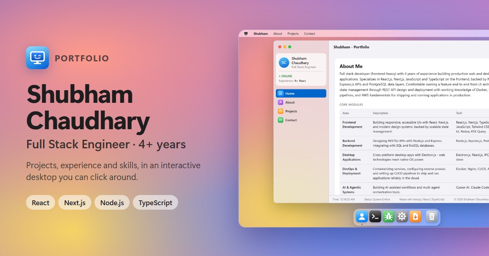

<div align="center">

# 🖥️ Shubham OS

**The portfolio of Shubham Chaudhary, Full Stack Engineer - built as an interactive desktop.**

Projects, experience and skills from 4+ years of building web and desktop apps with
React, Next.js and Node.js, presented as a small desktop you can click around: a menu
bar, a Dock, windows, a working Terminal and a few easter eggs. On phones it becomes
an app-style Home Screen.

[**▶ Visit the live site**](https://shubhamworks.vercel.app)


<br>



</div>

---

## About

This is the personal portfolio of **Shubham Chaudhary**, Full Stack Engineer with 4+ years
of experience in React, Next.js and Node.js. Instead of a typical landing page, it opens as a
small interactive desktop: a short startup screen, then a single window with About, Skills,
Projects, Experience and Contact. On phones (portrait, or landscape on a touch screen) it
becomes an app-style Home Screen.

The earlier Windows 95-style version is kept on the `windows-95-classic` branch.

It is a Next.js (App Router) app written in TypeScript with hand-written CSS -
no UI libraries, no CSS framework. All portfolio content is rendered on the
server, so it is in the HTML for search engines before any JavaScript runs.

## Features

| | |
|---|---|
| **Startup screen** | Logo, progress bar and boot steps. Click or press any key to skip. |
| **Windows** | An app-style window (sidebar with a profile card and sections), traffic-light buttons, drag, resize from 8 edges, zoom that glides the real frame, snap to screen edges, and a genie minimize into the Dock. |
| **Menu bar & Dock** | Logo menu, quick section links, a live clock; a Dock that magnifies smoothly with the pointer and bounces apps as they launch. |
| **Terminal** | A real command parser with history (↑ / ↓). |
| **Desktop** | Draggable icons, a custom right-click menu and a sticky note with a new motto every hour (a widget on the phone Home Screen). |
| **Time Machine** | The career as "desktop snapshots" flying through a starfield: scroll, swipe, use the arrow keys or pick a year; a big year counter rolls through every year in between. The green button takes it full screen. |
| **Activity Monitor** | The skills as running processes: live load graph, filter by group, sortable columns, and a "Used in" panel listing the jobs and projects that use each one. |
| **About This Developer** | A Mac-style About window: photo, role and a playful spec sheet (years in IT, projects shipped, live career uptime). |
| **System Settings** | Light (default) / Dark / Auto appearance, 8 gradient wallpapers (the default one drifts slowly) and a Larger Text switch. |
| **On phones** | Full-screen apps with a tab bar and a "< Home" button, a Home Screen and dock, action sheet, bottom sheets and alerts. |
| **Contact form** | Sends via Web3Forms (honeypot spam trap, 5 messages per minute per visitor); falls back to your mail app via `mailto:`. |
| **Resume Installer** | A step-by-step installer that "installs" the resume PDF. |
| **Debug Runner** | A tiny jump-over-the-bugs game with a saved best score. |
| **Installable** | Works offline as a PWA via a service worker. |
| **Analytics** | Vercel Web Analytics (cookieless page views), active only on Vercel deployments. |

All preferences are stored in `localStorage`, and every animation respects
`prefers-reduced-motion`. Menus, tabs, window buttons and dialogs are keyboard
operable (Enter/Space to activate, Escape to close).

The look is inspired by Apple's, not copied: no Apple logo, icons, wallpapers or
fonts are used. Text uses the device's system font (so Apple devices show their own);
dates, tech tags and the Terminal use JetBrains Mono (free, served from the site).

## Try the Terminal

Open **Terminal** from the Dock, the desktop or the logo menu and type `help`.

```text
shubham@portfolio ~ % whoami
shubham@portfolio ~ % skills
shubham@portfolio ~ % projects
shubham@portfolio ~ % resume
shubham@portfolio ~ % sudo hire-me
```

There are a few undocumented commands too. Minimizing the main window is also
worth a try.

## Run locally

Requires Node.js 20.9+ (developed on Node 24) and npm.

```bash
npm install
npm run dev        # http://localhost:3000
```

Other scripts:

```bash
npm run build      # production build (also type-checks)
npm start          # serve the production build
npm run lint       # ESLint (Next.js + React Compiler rules)
npm run typecheck  # tsc --noEmit
npm run test:e2e   # browser tests (Playwright)
```

### Browser tests

`npm run test:e2e` builds the site into its own folder (`.next-e2e`, so your normal build is
untouched), starts it on port 3200 and runs the tests in `tests/e2e/` in Chromium, at desktop
size and at phone size (375×667, touch). They cover the boot screen, tabs, the Terminal, Dock
minimize/restore, zoom, the default Light appearance, the quit prompt, saved appearance, Larger Text,
the Time Machine, Activity Monitor, About This Developer, the sticky note, the contact form
(sending, burst submits, the 5-per-minute limit, the honeypot, the mail-app fallback) and the
phone layout (full-screen app, tab bar, Home Screen, action sheet, bottom sheets).

The tests never send real mail: they use a fake Web3Forms key and stub `api.web3forms.com`.
First time on a new machine, install the browser with `npx playwright install chromium`.

The service worker is only registered in production builds (`npm run build && npm start`),
so development never serves stale cached bundles.

## Project structure

```text
app/
  layout.tsx            # <html>, metadata, pre-paint theme script, SW registration
  page.tsx              # the single page: server-rendered sections -> desktop
  not-found.tsx         # 404 page as a desktop-style alert
  sitemap.ts robots.ts manifest.ts
  globals.css           # imports the stylesheets in styles/
components/
  os/                   # OsProvider (shared state + actions), ShubhamOS root, BootScreen
  windows/              # generic Window (drag/resize/snap/animate), MainWindow, TerminalWindow
  desktop/              # menu bar, Dock, logo menu, icons, context menu, sticky note, live wallpaper, notifications
  dialogs/              # generic Dialog (alerts + panels/sheets), Trash, game, settings, installer,
                        # Time Machine, Activity Monitor, About This Developer
  portfolio/            # About, Skills, Projects, Experience, Contact (server components)
  live/                 # small client readouts: clock, career stats, year, visitor counter
  shared/               # JSON-LD script, service worker registration
  icons/                # hand-drawn app tiles and line icons (Apple-inspired, not Apple assets)
data/                   # portfolio content: profile, about, skills, projects, experience
lib/                    # site config, themes, wallpapers, Terminal commands, storage, motion, starfield, skill usage
tests/e2e/              # Playwright browser tests (desktop + phone)
styles/                 # CSS by area; ios.css holds the phone layout
public/                 # resume PDF, app icon (icon.svg + rendered PNGs), og-image, sw.js
```

### How it fits together

- **Content is data.** Edit `data/*.ts` to change projects, experience or skills.
  Entries with `hidden: true` are kept but not rendered.
- **Server vs client.** Portfolio sections are Server Components. They are passed as
  props into the client-side desktop (`components/os/ShubhamOS.tsx`), which only decides
  which sections a tab shows and in what order.
- **State.** `OsProvider` holds dialogs, menus, tabs, toasts and window status in a
  reducer and exposes stable actions (`useOsActions()`), e.g. `showToast`, `showMessage`,
  `openDialog`, `goToSection`, `openTerminal`, `toggleMenu`.
- **Windows.** `components/windows/Window.tsx` is the one draggable/resizable window
  implementation. Reuse it for any new window instead of duplicating drag/resize logic.
- **Preferences** use small `localStorage`-backed stores (`lib/preferences.ts`) read
  through `useSyncExternalStore`, so server HTML and the first client render always match.

## Deploy to Vercel

The repo includes `vercel.json` with `"framework": "nextjs"`, so Vercel builds it as a
Next.js app (important because this project previously deployed as a static site).

1. Push the branch and open the project on Vercel (or run `vercel` / `vercel --prod`).
2. Check **Project Settings → Build & Development**: Framework Preset *Next.js*,
   build command `next build`, and no custom output directory left over from the static setup.
3. Add the environment variable `WEB3FORMS_ACCESS_KEY` (see below) and deploy.

## Contact form (Web3Forms)

1. Create a free access key at [web3forms.com](https://web3forms.com) with the email address
   that should receive messages.
2. Set `WEB3FORMS_ACCESS_KEY` in Vercel (**Settings → Environment Variables**, Production
   and Preview) and in `.env.local` for local testing, then redeploy. The value is read at build time
   (the page is statically generated), so changing it needs a redeploy.

How it behaves:

- With a key: the message is sent from the page, a toast confirms it and the form clears.
- If sending fails (network error, quota reached): the visitor's email app opens with the
  message prefilled instead.
- Without a key: the form only uses the `mailto:` fallback (the original behavior).
- A hidden `botcheck` checkbox catches simple bots; their submissions are silently dropped.
- Each visitor can send up to 5 messages per minute. Over the limit, a "Please wait" toast
  shows how many seconds are left and the typed text stays in the form. Send times are kept in
  `localStorage`, so refreshing the page doesn't reset the limit. Submits fired at the same
  instant (e.g. by a script) only send once.
- The key is visible in the page source by design: Web3Forms only accepts browser submissions on the
  free plan (server-side calls need a paid plan with a safelisted IP), and their docs state the key
  is public. It can only deliver messages to your inbox.
  If spam still gets through, add hCaptcha (free on Web3Forms; Cloudflare Turnstile and reCAPTCHA
  need a paid plan).

## Web Analytics

The site uses [Vercel Web Analytics](https://vercel.com/docs/analytics) (`<Analytics />` in
`app/layout.tsx`). To see data:

1. In Vercel, open the project → **Analytics** tab → **Enable** (once per project).
2. Deploy. Page views appear in the Analytics tab within a few minutes of visits.

The component is only rendered in builds made on Vercel (`process.env.VERCEL`), because its script
is served by Vercel itself; local `npm run dev` / `npm start` don't load it.

## Custom domain

1. In Vercel: **Project → Settings → Domains → Add**, enter your domain and follow the
   DNS instructions (an `A` record for the apex domain or a `CNAME` for `www`).
2. Set **`NEXT_PUBLIC_SITE_URL`** to the new origin (e.g. `https://your-domain.com`) in
   **Settings → Environment Variables** for *Production*, then redeploy.

The site URL drives the canonical link, Open Graph/Twitter URLs, JSON-LD, `sitemap.xml`
and `robots.txt`. It is resolved in `lib/site.ts` in this order:

1. `NEXT_PUBLIC_SITE_URL`, if set
2. `VERCEL_PROJECT_PRODUCTION_URL` (set automatically by Vercel; it prefers your custom
   domain once one is attached)
3. `https://shubhamworks.vercel.app`

See `.env.example`. After switching domains, re-submit the sitemap in Google Search Console.

## Design notes

- Apple-inspired desktop on computers, app-style Home Screen on phones, chosen by one media query
  (`(max-width: 700px), (max-height: 500px) and (pointer: coarse)`, also `PHONE_QUERY`
  in `lib/motion.ts`). Same components; `styles/ios.css` restyles them.
- Colors are CSS variables in `styles/base.css`, with a light and a dark set. The blue is
  `#0066cc` (light) / `#4da3ff` text and `#0068d6` buttons (dark), so small text passes
  WCAG AA contrast.
- Motion uses Apple-like curves (`cubic-bezier(0.32, 0.72, 0, 1)` and a gentle spring);
  everything is skipped under `prefers-reduced-motion`. The genie minimize warps thin copies of the
  window with transforms only (`lib/motion.ts`), so it stays smooth.
- Icons and wallpapers are hand-made, inspired by Apple's style rather than copied from it.
- One scrolling window, kept deliberately simple, rather than a full desktop simulator.

## Contact

**Shubham Chaudhary**

[Portfolio](https://shubhamworks.vercel.app) ·
[GitHub](https://github.com/chaudharyShub) ·
[LinkedIn](https://www.linkedin.com/in/shubham-chaudhary-4398bba8)

<div align="center">
<br>
<sub>It is now safe to turn off your computer.</sub>
</div>
