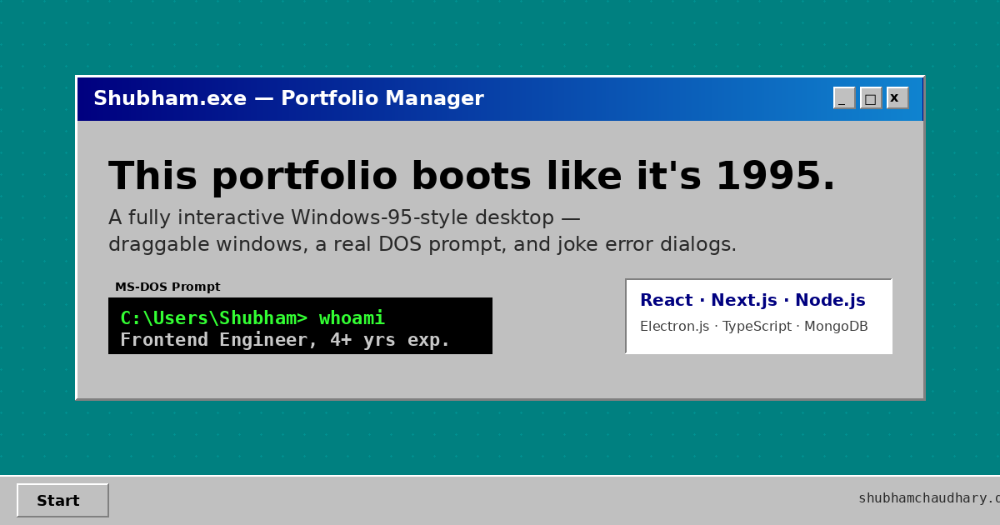

<div align="center">

# 🖥️ Shubham OS

**A portfolio that boots like it's 1995.**

A single-page portfolio dressed up as an interactive Windows 95 desktop —
draggable windows, a working DOS prompt, a Start menu, and a few easter eggs.

[**▶ Visit the live site**](https://shubhamworks.vercel.app)


<br>



</div>

---

## About

This is the personal portfolio of **Shubham Chaudhary**, Full Stack Engineer.
Instead of a typical landing page, it is a small Win95-style "operating system":
the site plays a BIOS boot sequence, then opens a single window containing
About, Skills, Projects, Experience and Contact.

The whole thing is plain HTML, CSS and JavaScript in one `index.html` —
no frameworks, no bundler. The only dependency is the Anthropic SDK, used by the
`api/chat.js` serverless function behind the chat window.

## Features

| | |
|---|---|
| **Boot screen** | BIOS-style startup sequence. Click or press any key to skip. |
| **Window manager** | Drag, resize from 8 edges, minimize, maximize, and snap to screen edges. |
| **MS-DOS Prompt** | A real command parser with history (↑ / ↓). |
| **Ask Shubham** | A chat window that answers questions about me from `profile.json`, using Claude via a Vercel function, with an offline keyword fallback. |
| **Start menu & taskbar** | Quick links, a live clock, and animated minimize-to-taskbar. |
| **Desktop** | Draggable icons and a custom right-click menu. |
| **Display Properties** | 3 themes (Win95, Win98, Terminal), 9 wallpapers, CRT scanlines, cursor trail. |
| **Resume Setup Wizard** | An InstallShield-style installer that "installs" the resume PDF. |
| **Debug Runner** | A tiny jump-over-the-bugs game with a saved best score. |
| **Installable** | Works offline as a PWA via a cache-first service worker. |

All preferences are stored in `localStorage`, and every animation respects
`prefers-reduced-motion`.

## Try the DOS prompt

Open **MS-DOS Prompt** from the desktop or Start menu and type `help`.

```text
C:\Users\Shubham> whoami
C:\Users\Shubham> skills
C:\Users\Shubham> projects
C:\Users\Shubham> resume
C:\Users\Shubham> sudo hire-me
```

There are a few undocumented commands too. Minimizing the main window is also
worth a try.

## Run locally

Serve the folder with any static server — opening `index.html` straight from
disk can break relative paths in some browsers.

```bash
python -m http.server 8000
```

Then open <http://localhost:8000>.

## Project structure

```text
.
├── index.html              # the entire site: markup, styles, scripts
├── sw.js                   # service worker (offline cache)
├── manifest.json           # PWA manifest
├── Shubham_resume.pdf      # downloadable resume
├── wallpaper-*.svg         # five scenic wallpapers
├── og-image.png            # link preview image
├── favicon.* / icon-*.png  # winking CRT monitor icon set
└── robots.txt, sitemap.xml # SEO
```

All files need to stay in the same folder, since `index.html` references them
with relative paths.

## Design notes

- The Win95 bevel is the design: gray `#c0c0c0`, navy `#000080`, inset and
  outset borders, and nothing more modern than that.
- Icons and wallpapers are hand-drawn SVG, inspired by the era rather than
  copied from it. No Microsoft assets are used.
- One scrolling window, kept deliberately simple, rather than a full desktop
  simulator.

## Contact

**Shubham Chaudhary**

[Portfolio](https://shubhamworks.vercel.app) ·
[GitHub](https://github.com/chaudharyShub) ·
[LinkedIn](https://www.linkedin.com/in/shubham-chaudhary-4398bba8)

<div align="center">
<br>
<sub>It is now safe to turn off your computer.</sub>
</div>
