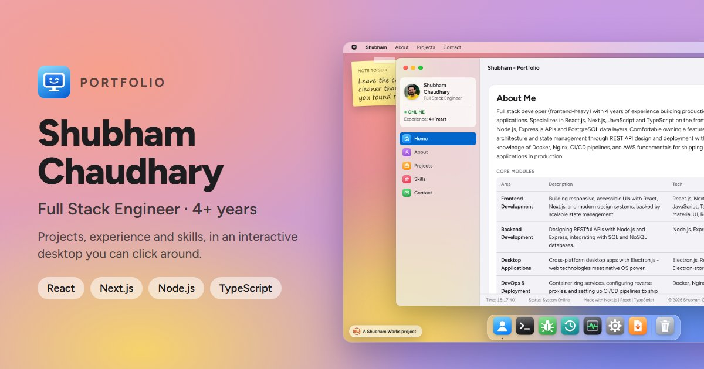

<div align="center">

# 🖥️ Shubham OS

**The portfolio of Shubham Chaudhary, Full Stack Engineer - built as an interactive desktop.**

Projects, experience and skills from 4+ years of building web and desktop apps with
React, Next.js and Node.js, presented as a small desktop you can click around: a menu
bar, a Dock, windows, a working Terminal and a few easter eggs. On phones it becomes
an app-style Home Screen.

[**▶ Visit the live site**](https://shubhamworks.vercel.app)


<br>



</div>

---

## About

This is the personal portfolio of **Shubham Chaudhary**, Full Stack Engineer with 4+ years
of experience in React, Next.js and Node.js. Instead of a typical landing page, it opens as a
small interactive desktop: a short startup screen, then a single window with About, Projects
(grouped by company, then personal projects), Skills, Experience and Contact. On phones it
becomes an app-style Home Screen.

This is a personal project, not an open-source template.

## What's inside

| | |
|---|---|
| **Startup screen** | Logo, progress bar and boot steps. Click or press any key to skip. |
| **Windows** | An app-style window with a sidebar, traffic-light buttons, drag, resize, snap to screen edges, a full-screen zoom and a genie minimize into the Dock. |
| **Menu bar & Dock** | Logo menu, section links, a live clock; a Dock that magnifies with the pointer and bounces apps as they launch. |
| **Terminal** | A real command parser with history (↑ / ↓). |
| **Time Machine** | Life from birth to today - school, college, jobs, and the MBA on a side lane beside the job - as snapshots flying through a starfield. Try going back past 1995. |
| **Activity Monitor** | The skills as running processes, with a live load graph and the jobs and projects that use each one. |
| **About This Developer** | A Mac-style About window with a playful spec sheet. |
| **System Settings** | Light / Dark / Auto, 8 gradient wallpapers and a Larger Text switch. |
| **Phones** | Full-screen apps with a tab bar, a two-page Home Screen, a Dock, action sheets and bottom sheets. |
| **Writing** | A desktop app with my latest posts from Hashnode and dev.to and their cover images, updated by themselves when I publish. |
| **Contact** | A contact form and every profile link in one place. |
| **Likes** | A heart with a shared like count that beats once after you've looked around for a bit; click again to take it back. |
| **Debug Runner** | A small runner game: hop the bugs, hold to long-jump memory leaks, stay under the 404s, grab coffee for hotfix mode and ship a version every 100 points. Shows your score, your best and the top score of all players. |
| **And more** | A sticky note, a resume "installer" and the Trash. |

## Try the Terminal

Open **Terminal** from the Dock, the desktop or the logo menu and type `help`.

```text
shubham@portfolio ~ % whoami
shubham@portfolio ~ % skills
shubham@portfolio ~ % projects
shubham@portfolio ~ % resume
shubham@portfolio ~ % blog
shubham@portfolio ~ % links
shubham@portfolio ~ % sudo hire-me
```

There are a few hidden commands too; `hint` gives a clue. Minimizing the main window is also
worth a try.

## How it's built

- **Next.js App Router, TypeScript (strict), plain CSS.** No UI library, no CSS framework, no
  CSS-in-JS; the only runtime dependencies are Next.js, React and Vercel's analytics.
- **Built with AI assistance.** AI coding tools helped write the code; what the site is, what
  made it in and what got cut were decided and tested by me on real devices.
- **Server-rendered content.** Every portfolio section is a Server Component, so all the text is
  in the HTML for search engines before any JavaScript runs; the client desktop only decides
  which sections a tab shows.
- **Blog posts without a CMS.** The Writing app reads my Hashnode RSS feed (and dev.to's API
  for the cross-post links) on the server and refreshes once a day with incremental static
  regeneration, so new posts appear without a deploy.
- **One generic window.** Drag, 8-edge resize, snapping, zoom and minimize live in a single
  `Window` component that every app reuses.
- **Smooth animations on modest hardware.** The genie minimize warps thin copies of the window
  with transforms only, prepared before the click; zoom glides the real frame while the content
  is laid out once. Everything respects `prefers-reduced-motion`.
- **A small, abuse-resistant API.** The like counter and the Debug Runner top score are Next.js
  routes over Upstash Redis (plain `fetch`, no client library). Likes use server-issued ids so
  nobody can remove other people's likes, and a per-network daily limit that never stores raw IP
  addresses. A top score only counts with a signed, single-use run ticket, and can't be higher
  than the time since that run started allows, so faking one takes as long as playing for it.
- **No hydration flashes.** Saved preferences are read through `useSyncExternalStore`, and a tiny
  pre-paint script applies the theme before the first frame.
- **Accessible.** Keyboard-operable menus, tabs and dialogs, focus that returns where it came
  from, and colors chosen to pass WCAG AA. Lighthouse accessibility: 100.
- **Tested.** Playwright browser tests at desktop and phone sizes cover the boot screen, windows,
  Terminal, Time Machine, contact form, likes, the game's top score and the phone layout.
- **Own assets.** Inspired by Apple's design, not copied: the icons, emoji, wallpapers and app icon
  are drawn for this site, and the fonts (Figtree and JetBrains Mono) are free and served from it.

## Contact

**Shubham Chaudhary**

[Portfolio](https://shubhamworks.vercel.app) ·
[GitHub](https://github.com/chaudharyShub) ·
[LinkedIn](https://www.linkedin.com/in/shubham-chaudhary-4398bba8) ·
[dev.to](https://dev.to/shubham_works) ·
[Hashnode](https://shubham-works.hashnode.dev)

<div align="center">
<br>
<sub>It is now safe to turn off your computer.</sub>
</div>
